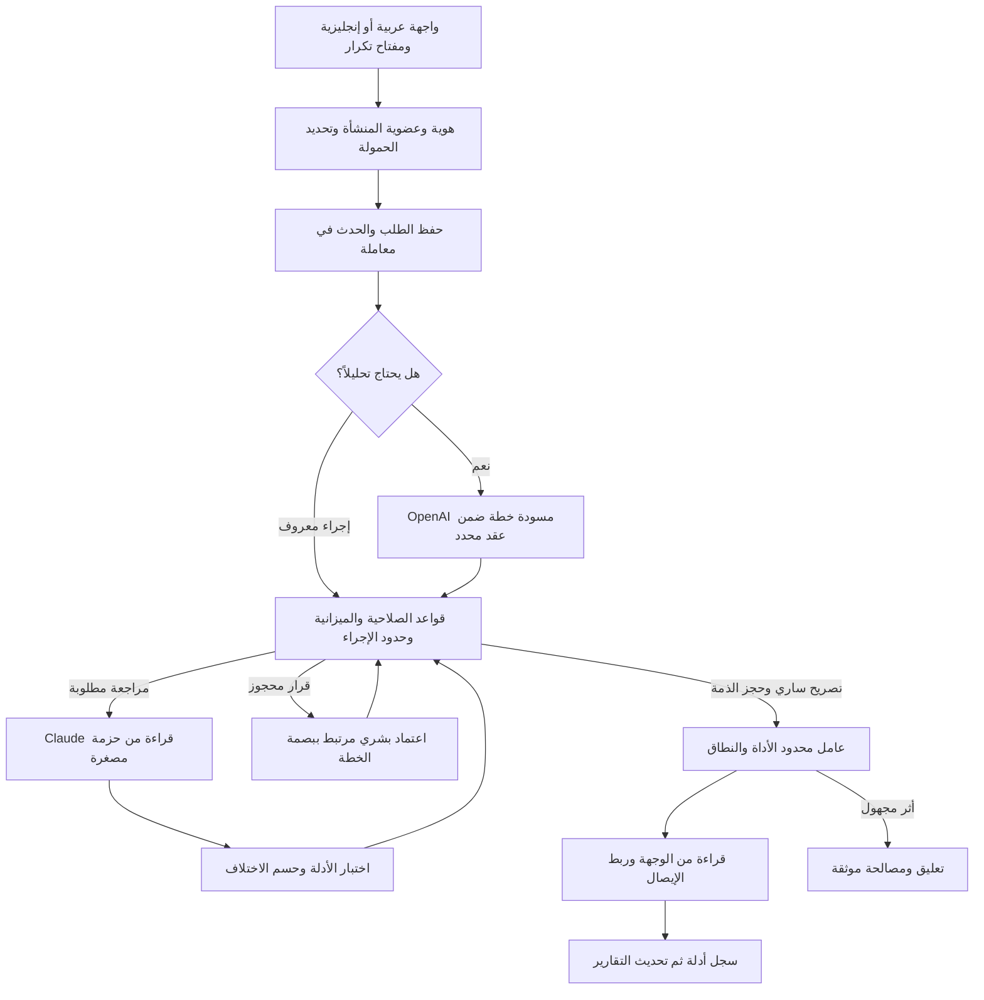

# معمارية دراقون وقرار اختيار النموذج

سجل قرار هندسي | 26 نوفمبر 2026 | المالك المقترح: مسؤول المنصة | حالة القرار: تصميم مرشح للاختبار في بيئة مرحلية. نطاق المراجعة يشمل إدارة الطلب، اتخاذ القرار، التشغيل الميداني، سجل الأثر، وربط خدمات أصول الضيافة.

## اختيار النمط

الدرجات أدناه أحكام تصميمية لورشة القرار من 1 إلى 5، حيث تعني الدرجة الأعلى خاصية أكثر ملاءمة لدراقون عند مستوى التعقيد المتوقع. السرعة تخص إنجاز المهمة، والكلفة تخص الاقتصاد، والصيانة تخص سهولتها، والاستقلال يقيس القدرة على العمل دون تدخل، و«تعدد المزود» يقيس سهولة الاستبدال. يتطلب إثبات الأداء قياسات تشغيلية موحدة. بعض الصفوف أنماط بنية، وبعضها ضوابط يمكن تركيبها على النمط المختار.

| النمط | قرار | ثبات | أمان | سرعة | كلفة | صيانة | توسع | تدقيق | استقلال | تعافٍ | تعدد المزود | مبرر التقدير في أصول الضيافة |
|---|---:|---:|---:|---:|---:|---:|---:|---:|---:|---:|---:|---|
| وكيل واحد | 3 | 2 | 2 | 5 | 5 | 5 | 3 | 2 | 4 | 2 | 2 | مناسب لصياغة طلب مبهم. تعطل النموذج يعطل السلسلة إذا جمع القرار والتنفيذ. |
| وكلاء متعاونون | 4 | 2 | 2 | 2 | 2 | 2 | 3 | 2 | 5 | 2 | 3 | يوسّعون زوايا التحليل مع كلفة تنسيق واحتمال تمرير استنتاج ضعيف بين الوكلاء. |
| تسلسل هرمي للوكلاء | 4 | 2 | 2 | 2 | 1 | 1 | 4 | 3 | 5 | 2 | 3 | يمكن تفويض نطاق واسع، ويصعب عزل أثر خطأ في تعليمات الوكيل الأعلى. |
| مشرف وعمال متخصصون | 4 | 3 | 3 | 3 | 3 | 3 | 4 | 4 | 4 | 3 | 3 | مناسب لتوزيع التحليل إذا بقيت أدوات التغيير خارج المشرف والعامل. |
| أحداث وطوابير | 2 | 4 | 4 | 4 | 4 | 3 | 5 | 4 | 4 | 5 | 5 | يعزل انقطاع المستهلك وينظم الإعادة؛ لا يحل غموض الطلب بمفرده. |
| سير عمل بخطوات لوكلاء | 4 | 3 | 3 | 3 | 3 | 4 | 4 | 4 | 4 | 3 | 3 | يحدد نقاط توقف ومخرجات، وتتأثر زمنية السلسلة باستدعاءات النماذج. |
| ذكاء تحليلي وأتمتة حتمية | 4 | 5 | 4 | 4 | 4 | 4 | 4 | 5 | 4 | 4 | 4 | تصنف النماذج الغموض، وتنفذ خدمة محدودة الصلاحيات الإجراء المسجل. |
| نماذج متعددة | 4 | 3 | 3 | 2 | 2 | 3 | 3 | 4 | 4 | 4 | 4 | مراجعة ثانية عند المخاطر العالية. اختلاف النموذجين يحتاج مرجعاً وفحصاً. |
| إنسان ضمن دورة القرار | 5 | 4 | 5 | 2 | 2 | 3 | 2 | 5 | 1 | 3 | 5 | يحسم أثر التزام مالي أو قرار ميداني، وقد يصبح طابور الموافقات عنق زجاجة. |
| طبقة تحكم مؤسسية | 4 | 4 | 5 | 3 | 3 | 2 | 5 | 5 | 4 | 4 | 5 | توحد الإذن والميزانية والتدقيق، ويتطلب تشغيلها خطة استعادة تمنع توقف التنفيذ كلياً. |

**القرار المقترح:** يجمع الإصدار التجريبي سير عمل حتمياً بسيطاً، ومخططاً تحليلياً عند الغموض، ومحرك صلاحيات مستقل قبل كل أثر. يقر صاحب التفويض الالتزامات المقيدة. يراجع Claude الحالات المبررة فقط. يبدأ التنفيذ بسجل معاملات دائم وطابور محدود لكل منشأة، ويُضاف فصل الخدمات أو تجزئة العمال حين تكشف القياسات ضغطاً متكرراً. توافق هذا الاختيار مع الفصل المنشور بين workflows وagents ومع خصائص التوصيل المتكرر للأحداث وحواجز الموافقة. [Anthropic](https://www.anthropic.com/research/building-effective-agents) · [Microsoft Azure](https://learn.microsoft.com/en-us/azure/architecture/guide/architecture-styles/event-driven) · [OpenAI](https://developers.openai.com/api/docs/guides/agents/guardrails-approvals)

## البنية المستهدفة وتفويض الوكلاء

تعبر جميع عمليات الكتابة بوابة السياسة. يستهلك مسار المراجعة إصداراً واحداً من القرار ويحفظ حالته، ويعيد فتحه فقط إذا تغيرت بصمة الخطة، أو انتهت الصلاحية، أو ظهر دليل جديد. عند فشل التحقق يعود الطلب للمراجعة البشرية بعد العدد المعتمد للمحاولات. الوصول المباشر للنموذج إلى قاعدة التشغيل أو مفاتيح النشر خارج تصميم التفويض. هوية الخدمة المنفذة منفصلة عن هوية مصدّق الإيصال وعن مقدم الاعتماد.

## قدرات الذكاء الأربع عشرة

| مجموعة التشغيل | القدرات | المخرج ومسؤول اعتماده |
|---|---|---|
| توجيه الإدارة | استراتيجي، قراري، مخاطر | خيارات موثقة وتكاليف وفرص ومخاطر تصل إلى صاحب الصلاحية |
| اقتصاد العميل | مالي، تجاري، عملاء | هامش العقد، توقع الطلب وأسباب الشكوى. تعتمد المالية الأسعار والالتزامات |
| أداء المنشأة | تشغيلي، مرافق، أصول، تنبؤي | ترتيب عمل وقائي أو تصحيحي على أصل موثق، يراجع مدير المنشأة الإنذار قبل تدخل يمس السلامة |
| نزاهة التنفيذ | امتثال، تقني، جودة، معرفة | مصدر ساري، اختبار تغيير، وتحقق من إغلاق الملاحظة. تعتمد الإدارة المختصة التفسير النظامي أو الفني |

يربط المنسق هذه القدرات بمخطط وأدوات مشتركة. يحتفظ نظام أوامر العمل بحالة الأصل والزيارة. يحفظ سجل القرار الموافقة ونسخة الخطة، وCRM العميل والفرصة، والنظام المالي الالتزام والمصروف، وفهرس المعرفة المؤشرات إلى النسخ المعتمدة. تتطلب أي مزامنة مفتاحاً أصلياً وإصداراً ووقت المصدر ومالكاً لكل حقل. تُستخدم البيانات التشغيلية الحديثة في مسارات التقارير والتنبؤ بعد فحص الاكتمال والانحياز واختبار فائدة الإنذار ميدانياً.

## السعة والتوسع المرحلي

أعداد المنشآت أدناه مراحل تخطيط طلبها المؤسس. حمل منشأة موسمية وكثافة أوامرها وحجم الصور تحدد الموارد أكثر من عدد المنشآت وحده. تستخدم اختبارات الأحمال بيانات اصطناعية وخصائص موزعة ومزيج قراءة وكتابة مؤرخ، وتقيس نجاح المهمة المتحققة وتكلفتها.

| المرحلة | التغيير المشروط | دليل الانتقال المقبول |
|---|---|---|
| 10 منشآت | نشر تجريبي خاص مع طابور دائم منصف، عامل محدود، مناوب بشري، حظر نشر عام للبيانات | استعادة بيئة مرحلية، عزل مفاتيح المنشآت، اختبار اندفاع متزامن، تسوية قبل الإعادة، تطابق عينات أوامر العمل مع الزيارة |
| 100 منشأة | زيادة عدد العمال بحسب تراكم الطلب وعمر أقدم رسالة، فصل معالجة الوسائط عن الاستقبال | اجتياز حمل الذروة المتوقعة مع منشأة كثيفة النشاط، التزام زمن الإقرار وبقاء تكلفة المهمة ضمن السقف المعتمد |
| 1,000 منشأة | توزيع الطوابير، فصل التقارير الثقيلة، تحديد حصص الموردين، كشف التشبع على مستوى المنشأة | تمرين تعطل عامل وقاعدة احتياطية، إعادة أحداث دون ازدواج، اختبار عزل أفقي مبني على الأدوار، تقرير تكلفة وتوافر لمدة قياس متفق عليها |
| 5,000 منشأة | مجموعات تشغيل مستقلة حسب المخاطر والإقامة واحتياجات العقود، سعة احتياطية وإدارة إصدارات | تمرين فشل مجموعة واستعادتها تحت الحمل، صلاحية مواقع المعالجة، قياس SLA على المنشآت المتضررة، جدوى مالية بالعقود الفعلية |

## نقاط مراجعة القرار

يعاد تقدير فصل الخدمات عند تشبع قاعدة مشتركة أو اختلال العدالة بين المنشآت أو تجاوز تكلفة معالجة المهمة. يراجع اختيار النموذج عند تغير جودة المخرجات، الأسعار أو سياسة معالجة البيانات. لا تمنح درجات المقارنة اعتماداً إنتاجياً. خريطة التشغيل اليومية والقياسات والتعافي في operations.md، وعقد المراجع وبروتوكول المقارنة في models.md. تاريخ مراجعة المراجع الخارجية 26 نوفمبر 2026.
